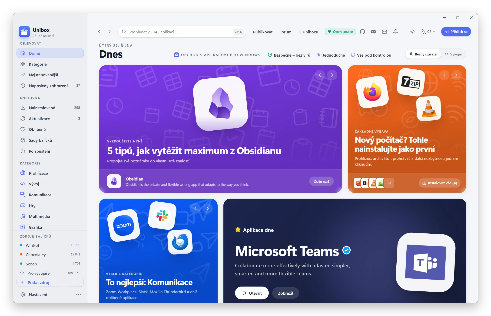
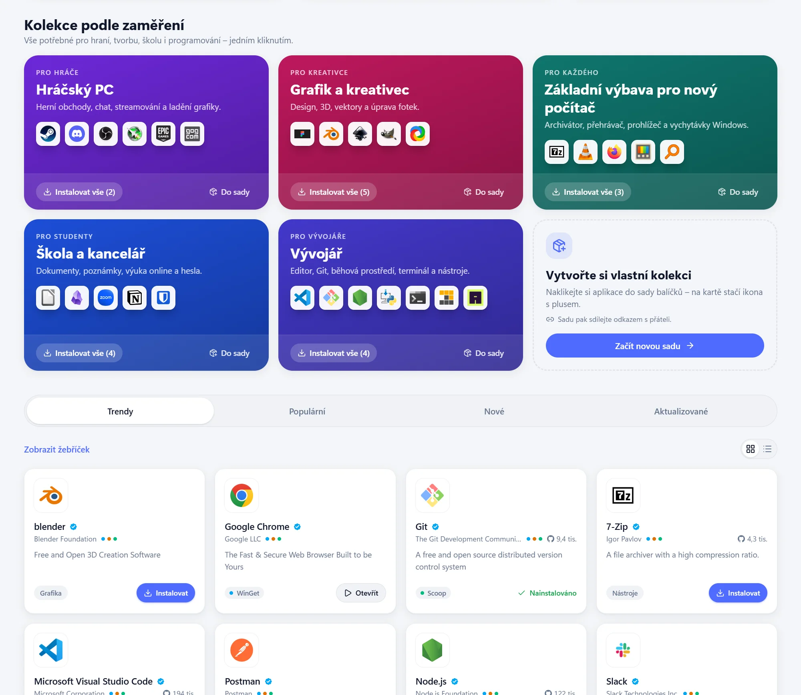
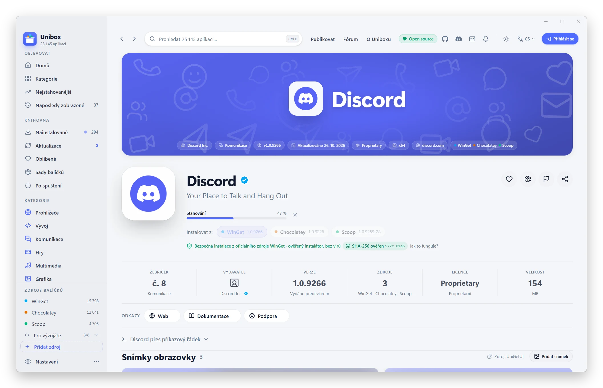
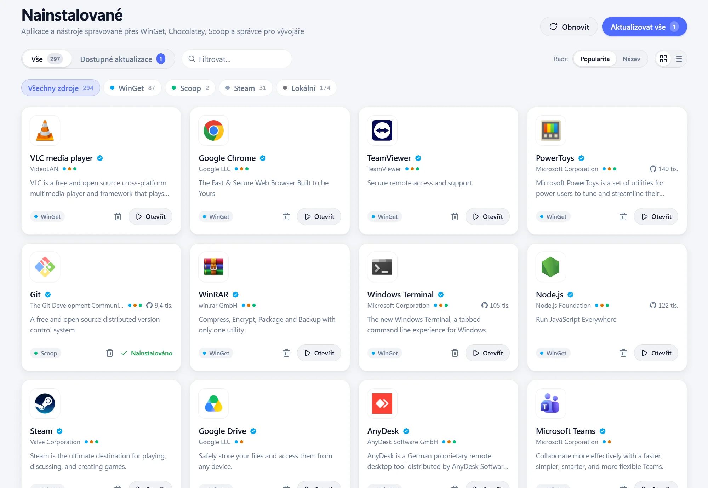

<div align="center">

[English](README.md) · **Čeština**


# Unibox

### Jeden obchod pro všechny aplikace ve Windows

Moderní obchod s aplikacemi pro Windows 10 a 11. Přes **25 000 aplikací** z oficiálních
repozitářů WinGet, Chocolatey a Scoop – instalace jedním kliknutím, bez hledání
instalátorů po webu, bez reklam a přibalených doplňků.

[](LICENSE) [](#stažení) [](https://tauri.app) [](https://react.dev) [](#zdarma-a-open-source)

**[⬇️ Stáhnout pro Windows](https://github.com/matous96/unibox/releases/latest)** &nbsp;·&nbsp; [Prohlídka](#prohlídka) &nbsp;·&nbsp; [Správci balíčků](#správci-balíčků) &nbsp;·&nbsp; [Pro vývojáře](#dokumentace-pro-vývojáře)

<br>

<picture>
  <source media="(prefers-color-scheme: dark)" srcset="assets/readme/cs/okno-tmave.webp">
  
</picture>

Domovská stránka Dnes – tipy, kolekce a Aplikace dne. Česky i anglicky, světlý i tmavý motiv podle Windows.

</div>

## Proč Unibox

| 🛡️ Bezpečné – bez virů | ⚡ Jednoduché | 🔄 Vše pod kontrolou |
|:---|:---|:---|
| Jen oficiální repozitáře správců balíčků. Každý instalátor se před spuštěním ověří kontrolním součtem SHA-256. | Jedno kliknutí místo průvodců instalací. Žádné „Další, Další, Dokončit“, přibalené doplňky ani reklamy. | Aktualizace a odinstalace všech aplikací na jednom místě – i těch, které jste nainstalovali dřív a jinak. |

Jedna aplikace = jedna karta. Když je aplikace ve více správcích balíčků, karta ukáže
všechny zdroje i s verzemi a vy si vyberete, odkud instalovat.

## Prohlídka

### Obchod a katalog

Domovská stránka **Dnes** s tipy ze stovek známých aplikací a každý den jinou Aplikací dne,
kategorie, žebříčky a kolekce podle zaměření – pro hráče, kreativce, studenty i vývojáře.
Vyhledávání přes <kbd>Ctrl</kbd>+<kbd>K</kbd> prohledá katalog i živě správce balíčků;
ověřené aplikace jsou ve výsledcích první.

<picture>
  <source media="(prefers-color-scheme: dark)" srcset="website/img/screens/kolekce.webp">
  
</picture>

### Detail aplikace jako v App Storu

Velký banner v barvách ikony aplikace, galerie snímků obrazovky s prohlížečem na celou
obrazovku, co je nového, hodnocení a recenze, ochrana soukromí a odkazy na web, GitHub,
dokumentaci a podporu. Technické údaje: SHA-256, typ instalátoru, systémové požadavky
a závislosti.

Instalace jedním kliknutím z vybraného zdroje, s průběhem stahování přímo v detailu.

<p align="center">
<picture>
  <source media="(prefers-color-scheme: dark)" srcset="assets/readme/cs/stahovani-tmave.webp">
  
</picture>
</p>

### Nainstalované a aktualizace

Přehled všech aplikací v počítači – i programů instalovaných mimo WinGet, aplikací
z Microsoft Storu a her ze Steamu. Aktualizace jedním tlačítkem **Aktualizovat vše**,
nebo automaticky podle plánu. Selže-li operace kvůli oprávněním, Unibox ji sám zopakuje
s právy správce.

<picture>
  <source media="(prefers-color-scheme: dark)" srcset="website/img/screens/nainstalovane.webp">
  
</picture>

### A k tomu

- 🧹 **Pokročilá odinstalace** – najde zbytky po odinstalaci (AppData, Program Files,
  nabídka Start, registr) a nabídne je smazat; se **sledováním instalace** smaže přesně to,
  co instalátor vytvořil.
- 🚀 **Po spuštění** – programy spouštěné po přihlášení do Windows na jednom místě,
  s vlivem na rychlost startu.
- ⏰ **Aktualizace pod kontrolou** – plán kontrol i instalací, minimální stáří
  aktualizací, výjimky pro baterii a varování, když instalátor přijde z jiného serveru.
- 📦 **Sady balíčků a profily** – sdílitelná sada aplikací pro nový počítač, export
  pro WinGet i jako skript PowerShellu.
- 💻 **Režim Vývojář** – npm, Bun, pip, Cargo, vcpkg, .NET Tool a PowerShell naostro
  a příkazy pro příkazovou řádku ke zkopírování.
- ⭐ **Komunita** – přihlášení přes GitHub, hodnocení, recenze a aktuální snímky obrazovky
  od uživatelů; synchronizace oblíbených a předvoleb mezi počítači.
- 🌙 **Moderní okno** ve stylu Windows 11, světlý i tmavý motiv, česky i anglicky; zavřete
  okno a instalace doběhnou na pozadí.

## Správci balíčků

| Správce | Stav | Co umí |
|---|---|---|
| **WinGet** | ✅ plně funkční | hledání, instalace, aktualizace, odinstalace i stažení instalátoru |
| **Chocolatey** | ✅ plně funkční | hledání, instalace, aktualizace a odinstalace; chybějící Chocolatey doinstaluje |
| **Scoop** | ✅ plně funkční | bez práv správce; chybějící Scoop, Git i buckety doplní sám |
| **npm, Bun, pip, Cargo, vcpkg, .NET Tool, PowerShell** | ✅ režim Vývojář | knihovny a nástroje; chybějící Node.js, Python či Rust doinstaluje přes WinGet |

## Stažení

**[Stáhnout nejnovější verzi](https://github.com/matous96/unibox/releases/latest)** –
instalátor **EXE** instaluje pro aktuálního uživatele bez práv správce, **MSI** se hodí
pro nasazení ve firmách. Požadavky: Windows 10 nebo 11 (64bit) a WebView2, který je ve
Windows předinstalovaný. Unibox se pak aktualizuje sám. Víc na webu:
[matous96.github.io/unibox](https://matous96.github.io/unibox/).

> [!NOTE]
> Instalátor zatím není digitálně podepsaný (podpis přes SignPath Foundation
> připravujeme). Edge může hlásit, že se soubor „běžně nestahuje“ (**… → Ponechat →
> Zobrazit další → Přesto ponechat**), a Windows SmartScreen při prvním spuštění zobrazí
> varování (**Další informace → Přesto spustit**).

## Zdarma a open source

Unibox je zdarma, bez reklam a bez telemetrie, pod licencí [MIT](LICENSE). Katalog se
každý den generuje na GitHub Actions, přihlášení, hodnocení a synchronizace běží na
bezplatném tarifu Supabase. Přihlášení je dobrovolné – bez účtu funguje všechno kromě
hodnocení, recenzí a synchronizace.

---

## Dokumentace pro vývojáře

Tauri 2 (Rust) + React 19 + TypeScript + Tailwind CSS v4 + Vite, data pipeline v Node.js.
Rychlý start: `pnpm install` a `pnpm desktop` (podrobnosti níže).

### Více správců balíčků

- `src/services/managers/types.ts` – rozhraní `PackageManager` (stav, instalace
  správce, nainstalované, hledání, operace s průběhem).
- `src/services/managers/sources.ts` – popis zdrojů a sestavení CLI příkazů.
- `src/services/managers/mock.ts` – ukázkové implementace pro vývoj v prohlížeči.
- Katalog (schéma v2) má u každé aplikace pole `sources`
  (`{ source, packageId, version, … }`). Data pipeline páruje balíčky napříč
  repozitáři podle monikeru wingetu, názvu a id – viz [data-pipeline/README.md](data-pipeline/README.md).

## Spuštění (webová verze s ukázkovými daty)

Požadavky: Node.js 20+ a pnpm.

```bash
pnpm install
pnpm dev
```

Aplikace poběží na <http://localhost:1420>. Všechny operace (instalace,
aktualizace, odinstalace) se v tomto režimu jen **simulují** – nic se doopravdy
neinstaluje.

Další příkazy:

```bash
pnpm typecheck   # kontrola typů
pnpm build       # produkční build do dist/
```

## Desktopová aplikace (Tauri 2)

Požadavky navíc: Rust (`winget install Rustlang.Rustup`) a Visual Studio Build Tools
s C++ (`winget install Microsoft.VisualStudio.2022.BuildTools --override "--wait --passive
--add Microsoft.VisualStudio.Workload.VCTools --includeRecommended"`). WebView2 je ve
Windows 10/11 předinstalovaný.

```bash
pnpm desktop         # vývoj: Vite + překlad Rustu + okno aplikace (port 1420 musí být volný)
pnpm desktop:build   # instalátory .msi a .exe (NSIS) do src-tauri/target/release/bundle
```

Backend je v `src-tauri/` (`src/lib.rs`, příkazy v samostatných modulech). Frontend
pozná desktopový režim funkcí `isTauri()` (`src/lib/tauri.ts`); ve webové verzi se
správci balíčků jen simulují.

#### Správci balíčků v desktopové aplikaci

winget, Chocolatey a Scoop běží naostro: hledání v repozitáři (`choco search`,
manifesty v bucketech Scoopu), verze, instalace, aktualizace, odinstalace a seznam
nainstalovaných. Chybí-li Chocolatey nebo Scoop, Unibox při instalaci z nich nabídne
jejich instalaci na jedno kliknutí oficiálním skriptem (`ManagerSetupDialog` –
Chocolatey s právy správce, Scoop bez nich). Přes kterého správce Unibox aplikaci
nainstaloval, si pamatuje (`store/installedVia.ts`) – štítek „Nainstalováno přes“
a správa sedí i po restartu.

**Správci pro vývojáře** (`src-tauri/src/dev.rs`, `src/services/managers/dev.ts`) – npm,
Bun, pip, Cargo, vcpkg, .NET Tool, PowerShell 7 (PSResourceGet) a Windows PowerShell 5.1
(PowerShellGet) – běží naostro, ale jen v režimu **Vývojář** (`activeSources`
v `store/settings.ts`): běžnému uživateli by do hledání přidali knihovny a zpomalili
seznam nainstalovaných.
- Nástroje se hledají v PATH z registru (nový Node.js či Python je vidět bez restartu
  Uniboxu – PATH procesu se doplní) a v obvyklých složkách (`.cargo\bin`, `.bun\bin`,
  `Program Files\nodejs`…); npm se spouští přímo jako `node npm-cli.js`, pip přes
  `py -3 -m pip` / `python -m pip` (ne zástupce Microsoft Storu).
- Nainstalované: `npm ls -g` + `npm outdated -g`, globální balíčky Bunu ze složky
  `~/.bun/install/global`, `pip list` (+ `--outdated`), `cargo install --list`,
  `vcpkg list` + `vcpkg update`, `dotnet tool list --global`, `Get-InstalledPSResource` /
  `Get-InstalledModule`; novější verze u Bunu, Carga a .NET z API registrů (npm,
  crates.io, NuGet) souběžně přes curl.exe.
- Hledání: API registrů npm, crates.io, NuGet (jen nástroje) a PowerShell Gallery;
  PyPI vyhledávací API nemá – přesná shoda názvu; vcpkg `vcpkg search`.
- Operace bez shellu (každý argument zvlášť), PowerShell skriptem; id balíčků a verze
  se ověřují (`valid_id`, `valid_version`) – jiné znaky do příkazu nejdou.
- Chybějící nástroj nainstaluje winget (`dev_setup`: Node.js LTS, Bun, Python 3.13,
  Rustup, .NET SDK 10, PowerShell 7); vcpkg jde nainstalovat jen ručně.
- Kontrola proti nástrojům v počítači (jen čtení):
  `cargo test --lib dev::tests::live -- --ignored --nocapture`.

**Běžící aplikace** (`src-tauri/src/running.rs`, `prepareProcesses` v `store/jobs.ts`):
před instalací, aktualizací a odinstalací Unibox najde procesy aplikace – podle složky
instalace z registru (jistě) a podle složky či souboru pojmenovaného jako aplikace
(`obs-studio`, `Discord.exe` – i bez záznamu v registru). U každého zjistí, jestli má
viditelné okno a jestli je okenní program (hlavička PE):
- proces bez okna, který aplikaci jistě patří (ikona u hodin, proces visící v paměti),
  ukončí bez dotazu – nejdřív slušně, kdo nereaguje, natvrdo – a zapíše to do protokolu
  (vypínač Nastavení → Obecné → Odinstalace a běžící aplikace),
- aplikaci s oknem, konzolový program a proces nalezený jen podle názvu nechá na
  uživateli: `AppRunningDialog` – Zavřít a pokračovat / Pokračovat bez zavření / Zrušit,
- po odinstalaci ukončí procesy, které z její složky dál běží (složku si backend
  pamatuje z doby před odinstalací), ať nedrží soubory.

Když operace i tak selže s „inUse“, `AppInUseDialog` nabídne aplikaci zavřít a operaci
zopakovat. Automatické aktualizace na pozadí aplikace nezavírají. Obecná slova
(„app“, „client“, „launcher“…) se jako název aplikace nepoužijí – „NVIDIA App“
tak nechytí cizí složku `app`.

**Záložní zdroj instalace:** když instalátor z manifestu wingetu nejde stáhnout
(nefunkční odkaz – HTTP 403/404/410 jako `0x80190194`, nesouhlasí kontrolní součet,
jiné selhání stažení), fronta úloh (`src/store/jobs.ts`) zkusí stejnou aplikaci
u dalších zapnutých a nainstalovaných správců aplikací podle priority z Nastavení
(Chocolatey, Scoop). Každý pokus je v historii operací; když selžou všechny,
uživatel dostane srozumitelnou hlášku s doporučením jiného zdroje.

| Modul (`src-tauri/src/`) | Co dělá |
|---|---|
| `process.rs` | CLI motor: spouštění bez okna konzole, výstup po řádcích (UTF-8, `\r` průběhu, točítko, escape sekvence), zrušení celého stromu procesů |
| `elevation.rs` | „Jako správce“: Unibox spustí sám sebe s `--unibox-elevated` přes UAC; povýšený proces spustí správce balíčků (jen povolené programy) a výstup zapisuje do dočasného souboru, který aplikace průběžně čte |
| `powershell.rs` | Trvale běžící PowerShell pro modul Microsoft.WinGet.Client – výpis nainstalovaných ~0,6 s, hledání ~0,2–1 s (první volání po startu déle) |
| `operations.rs` | Fronta operací (vždy jen jedna instalace najednou), předstažení instalátoru, opakování jako správce, zrušení podle id |
| `download.rs` | Stažení instalátoru přes `curl.exe` s průběhem v procentech a ověřením SHA-256 |
| `progress.rs` | Fáze a procenta operace pro kartu aplikace (posílá je frontendu kanálem) |
| `winget.rs` | Stav, nainstalované, hledání, verze, mezipaměť (`%TEMP%\WinGet`) přes PowerShell modul; instalace / aktualizace / odinstalace / stažení přes winget CLI |
| `choco.rs` | Chocolatey: stav (`choco --version`), nainstalované přenosné balíčky z manifestů `lib\*\*.nuspec` (programy s instalátorem ukazuje winget z registru), dostupné aktualizace (`choco outdated --limit-output`, frontend ho spouští na pozadí a výsledek drží 15 min v `localStorage`), instalace / aktualizace / odinstalace přes choco CLI; ve složce zapisovatelné uživatelem bez povýšení, jinak jako správce |
| `dev.rs` | Správci pro vývojáře (npm, Bun, pip, Cargo, vcpkg, .NET Tool, PowerShell 7 / 5.1): stav, nainstalované s aktualizacemi, hledání v registrech, verze, operace, instalace chybějícího nástroje přes winget |
| `scoop.rs` | Scoop: stav, nainstalované aplikace ze složek `apps\*\current` (novější verze z manifestu v bucketu), instalace / aktualizace / odinstalace / stažení přes `scoop.ps1` (chybějící oficiální bucket přidá) |
| `icons.rs` | Protokol `icon://` (`http://icon.localhost/…`): ikony z internetu i z nainstalovaných EXE s mezipamětí na disku |
| `arp.rs` | Záznamy „Programy a funkce“ (registr Uninstall, HKLM i HKCU) – ověření spustitelného souboru, pozůstatky po odinstalaci, záložní výpis nainstalovaných |
| `disk.rs` | Programy nalezené jen podle složky na disku (Program Files, %LocalAppData%, %AppData%) se zástupcem v nabídce Start |
| `leftovers.rs` | Zbytky po odinstalaci (AppData; s pokročilou odinstalací i Program Files, ProgramData, zástupci a registr), Koš a záloha registru, povýšený úklid |
| `running.rs` | Procesy aplikace (složka instalace, název, okno, GUI/konzole), zavření a ukončení |
| `startup.rs` | Programy po spuštění (registr Run, složky Po spuštění, plánovač úloh), zapnutí / vypnutí / odstranění, vliv na start (WDI StartupInfo) |
| `tracker.rs` | Sledování instalace – snímek disku a registru před a po instalaci, záznam pro čisté odinstalování |
| `oauth.rs` | Přihlášení v systémovém prohlížeči – návrat na 127.0.0.1 (RFC 8252) |
| `secure_store.rs` | Šifrované uložení přihlášení (Windows DPAPI) |
| `files.rs` | Uložení exportu přes dialog „Uložit jako“ |
| `apps.rs` | Položky nabídky Start (spuštění aplikace, ikona z EXE), ověření, že spouštěcí soubor existuje |
| `tray.rs` | Ikona v oznamovací oblasti s tečkou stavu operací, zavření okna = běh na pozadí |

- **Předstažení instalátoru:** winget stahuje přes Delivery Optimization, která soubor
  zapisuje až na konci (průběh nejde sledovat) a umí se i na minutu zastavit. Unibox
  proto zjistí instalátor (`winget show`: adresa, SHA-256) a stáhne ho sám přes curl
  tam, kde ho winget hledá (`%TEMP%\WinGet\<id>.<verze>\<sha256>`). winget pak jen
  ověří kontrolní součet a instaluje. Platí pro instalaci, aktualizaci i stažení.
  Když předstažení nejde (Microsoft Store, jiný instalátor), stahuje winget sám
  a procenta se odhadují z rostoucího souboru.
- **Opakování jako správce:** tichá odinstalace MSI nainstalovaného pro všechny
  uživatele bez práv správce končí chybou 1603 (`0x8A150030`). Tyto chyby
  (a „vyžaduje správce“, chyba instalátoru) Unibox automaticky zopakuje s právy
  správce (UAC).
- Aplikace s neznámou nainstalovanou verzí („Unknown“) se mezi aktualizace nepočítají –
  ani po aktualizaci verzi nezískají (stejně jako `winget upgrade` bez `--include-unknown`).
- Výsledek operace se čte z návratového kódu (HRESULT wingetu), ne z textu výstupu –
  winget je lokalizovaný. Kódy se překládají na srozumitelné hlášky (`wingetError.*`),
  „vyžaduje restart“ se oznámí zvlášť.
- Výstup příkazů se zapisuje do Protokolů (šedé řádky), hlášky Uniboxu (předstažení,
  opakování jako správce) jako varování.
- **Stav po operaci** (`store/afterOperation.ts`): karta i detail se po instalaci,
  aktualizaci a odinstalaci přepnou hned (optimistická úprava seznamu v cache), pak se
  seznam nainstalovaných a položky nabídky Start (tlačítko Otevřít) ověří u správce
  za 0 / 2,5 / 6 / 12 s – odinstalátory NSIS / MSI a instalátory typu Squirrel dokončují
  práci až po návratu wingetu. Fronta na ověření nečeká a pokračuje další operací.
- Výpis wingetu trvá ~1 s (dřív ~1,8 s): smyčka `foreach` místo `ForEach-Object`,
  `IsUpdateAvailable` jen u balíčků se zdrojem, klíče názvů z registru se počítají jednou.
  Hledání na disku přidá ~0,2 s; zástupce nabídky Start (~0,4 s) načte jen tehdy,
  když na disku něco najde, a minutu je drží v mezipaměti.
  Vyhledávání v katalogu používá předpočítaný index (`catalogSearchIndex`).
- Chybí-li modul Microsoft.WinGet.Client, Nastavení nabídne jeho instalaci
  (PowerShell Gallery, pro aktuálního uživatele).

#### Okno a běh na pozadí

- Okno nemá systémové dekorace (`decorations: false`); vlastní titulková lišta
  (`src/components/layout/TitleBar.tsx`) má zónu pro přetahování
  (`data-tauri-drag-region`, dvojklik = maximalizovat) a tlačítka minimalizace,
  maximalizace a zavření ve stylu Windows 11.
- **Spouštění při startu Windows** (Nastavení → Desktopová aplikace, výchozí vypnuto):
  tauri-plugin-autostart zapíše Unibox do `HKCU\Software\Microsoft\Windows\CurrentVersion\Run`
  s příznakem `--autostart` – po přihlášení se okno neotevře, Unibox běží jen jako ikona
  u hodin (okno se vytváří skryté, `visible: false`, a ukáže se jen při běžném spuštění).
- Zavření okna Unibox jen schová do oznamovací oblasti u hodin (vypnutelné
  v Nastavení → Desktopová aplikace); ikona ukazuje počet aktualizací. Nabídka
  ikony po vzoru UniGetUI: Procházet balíčky, Dostupné aktualizace, Nainstalované
  (ukážou okno na dané stránce – událost `tray-navigate`), Zobrazit Unibox, Ukončit.
  Druhé spuštění Uniboxu jen ukáže běžící okno (single instance).
- **Otevřít:** nainstalovanou aplikaci jde spustit z karty i z detailu (`src-tauri/src/apps.rs`,
  `src/lib/launch.ts`). Spustitelné aplikace jsou položky nabídky Start (složka
  `shell:AppsFolder` – klasické programy i aplikace ze Storu; bez odkazů na web,
  dokumentací a odinstalátorů), k aplikaci se najde podle AppID shodného s id wingetu
  (EA app), u programu nalezeného jen na disku podle zástupce do jeho složky, jinak
  podle názvu z katalogu, názvu balíčku a id wingetu. Položky, jejichž spouštěcí soubor
  na disku chybí (pozůstatky po odinstalaci), se vynechají – cíl zástupce
  (`System.Link.TargetParsingPath`) se ověří i u AppID, které cestou není
  (Discord: `com.squirrel.Discord.Discord` → `…\Discord.exe`). Spouští se jako z nabídky Start
  (`explorer shell:AppsFolder\<AppID>`), jen aplikace z aktuálního seznamu.
  Nástroje příkazové řádky bez položky v nabídce Start mají dál „Nainstalováno“.
- **Detekce nainstalovaných** (`winget_installed`) má tři úrovně:
  1. **winget** (`Get-WinGetPackage`) – chyba jednoho zdroje (msstore bez souhlasu,
     výpadek sítě) ani jednoho balíčku výpis neshodí. Každý balíček se spáruje se
     záznamem v registru (klíč `ARP\…`, název nebo poslední část id přesně, částečně
     jen se stejnou verzí) a ověří na disku,
  2. **registr** (HKLM 64/32 bit i HKCU), když výpis wingetu selže (chybí modul,
     jiná verze wingetu) – viditelné záznamy s odinstalací, bez součástí systému
     a aktualizací, se stejnými id jako u wingetu,
  3. **disk** (`disk.rs`) – složky v Program Files, `%LocalAppData%(\Programs)`
     a `%AppData%` s EXE pojmenovaným jako složka, které nezná winget ani registr.
     Počítají se jen se zástupcem v nabídce Start (EA app nechá po odinstalaci
     na disku i EXE) a jen spárované s katalogem; odinstalovat je Unibox neumí.

  **Ověření spustitelnosti** (`arp::presence`): program je nainstalovaný, jen když
  existuje jeho EXE – ne odinstalátor ani aktualizátor (Squirrel `Update.exe`):
  ikona záznamu, EXE ve složce instalace i v podsložkách (Discord `app-<verze>`),
  jinak ve složce odinstalátoru. Pozůstatek (Ollama: zbyly knihovny a záznam) se
  nepočítá. Záznamy, které odinstaluje systémový nástroj (MSI, ovladače NVIDIA přes
  rundll32), ověřit nejde a zůstanou; hry ze Steamu rozhoduje manifest
  `steamapps\appmanifest_<id>.acf`. Ověření jde i lokálně:
  `cargo test arp::tests::survey -- --ignored --nocapture` (a `disk::tests::survey`).

  Ke kartě z katalogu se nainstalovaný balíček přiřadí podle id, u varianty wingetu
  podle základního id (`Google.Chrome.EXE` → karta Google Chrome) a programy, které
  winget zná jen z registru (`ARP\User\X64\Discord`), podle názvu; složka z disku
  i bez hlavní verze nebo podle poslední části id wingetu („EA Desktop“ →
  `ElectronicArts.EADesktop`) (`useInstalledLinks` v `src/hooks/usePackages.ts`).
  Aktualizace, starší verze a příkazy pro příkazový řádek pak míří na skutečně
  nainstalovaný balíček.
- **Ikony (záložní systém, `src/lib/icons.ts`):** pro každou aplikaci se zkouší
  popořadě (1) skutečná ikona nainstalované aplikace z její položky v nabídce Start
  (IShellItemImageFactory – EXE, zástupci i Store; malá ikona v rámečku se ořízne),
  (2) ikona z katalogu (winget, databáze UniGetUI, Chocolatey, web aplikace – vybírá
  datová pipeline) a (3) vygenerovaný avatar s iniciálami na přechodu v barvě
  podle názvu. Favicony se za běhu nehledají – služby Googlu / DuckDuckGo by se
  dozvěděly, které aplikace si uživatel prohlíží. Vše jde přes protokol `icon://` s mezipamětí v
  `%LOCALAPPDATA%\org.unibox.app\icons`: ICO se převede na PNG, prázdné obrázky se
  odmítnou, téměř bílá ikona dostane tmavou dlaždici. Ikona z internetu menší než
  48 px se přeskočí jako nefunkční – všude by byla rozmazaná (katalog takové ikony
  neobsahuje, viz `data-pipeline/README.md`); menší ikona se nezvětší víc než 2×,
  ve velké dlaždici detailu je proto o kousek menší, ale ostrá. Zdroj bez ikony (HTTP 404, 403)
  se den nezkouší; po chybě sítě nebo přetížení serveru (HTTP 429 – Wikimedia
  a Chocolatey omezují počet požadavků – a 5xx) jen 15 minut. Stahuje se nejvýš
  6 ikon najednou.
  Clearbit Logo API už neexistuje a Icons8 vyžaduje klíč, proto je nepoužíváme.
- Ikona v oznamovací oblasti je jednobarevná verze loga (tahy 3 px na mřížce 32 × 32)
  na průhledném pozadí jako systémové ikony: `app.trayIcon` v `tauri.conf.json` →
  `icons/tray.png` (předloha 64 × 64, zdroj `assets/tray-icon.svg`, bílá). Na světlém
  hlavním panelu se přepne na tmavou `icons/tray-dark.png` (`assets/tray-icon-dark.svg`).
  PNG vzniknou příkazem `pnpm tauri icon assets/tray-icon.svg -o <složka> -p 64`
  (soubor `64x64.png`). `tray.rs` předlohu zmenší přesně na velikost ikon v oznamovací
  oblasti (16 px × měřítko Windows – 24 px při 150 %, 32 px při 200 %) a přidá tečku
  stavu operací: modrá = probíhá instalace / aktualizace, červená = chyba, zelená =
  hotovo (`set_tray_status`, stav počítá `hooks/useTrayStatus.ts`; výsledek zmizí po
  otevření okna, případně 10 s poté, co ho uživatel uvidí).
- Banner v detailu a karty na domovské stránce mají barvu podle ikony, kterou
  aplikace opravdu zobrazuje (`src/lib/iconColor.ts`, `hooks/useBrandPalette.ts`):
  nejčastější sytý odstín, černobílá ikona = neutrální. Ručně zvolená barva značky
  z katalogu (`curated.json`) se použije, jen když ji ikona obsahuje (vícebarevná
  loga – Chrome modře, ne náhodně oranžově; GOG se šedou ikonou ne fialově), nebo
  když ikonu nejde načíst. Bez ikony má banner odstín náhradního avataru s iniciálami.
  Text a štítky jsou bílé, kdykoli má bílá proti barvě (ztmavené jako místo s textem)
  kontrast aspoň 2,5 : 1 podle WCAG; tmavé jen na světlých barvách (`isLight` v `lib/color.ts`).

Testy backendu: `cd src-tauri` a `cargo test`.

### Skutečný katalog (data pipeline)

```bash
pnpm pipeline --local
```

Stáhne data z wingetu, Chocolatey a Scoopu (~25 000 aplikací), sestaví
`data-pipeline/out/catalog.json` a zkopíruje ho do `public/catalog.json`,
odkud ho `pnpm dev` načte místo ukázkového katalogu. Podrobnosti v
[data-pipeline/README.md](data-pipeline/README.md).

### Vzdálený katalog

Katalog denně generuje workflow **Katalog** (`.github/workflows/catalog.yml`) na GitHub
Actions a zveřejňuje ho zdarma na GitHub Pages spolu s webem (`website/`):
[matous96.github.io/unibox/catalog.json](https://matous96.github.io/unibox/catalog.json),
web na [matous96.github.io/unibox](https://matous96.github.io/unibox/). Změna webu
v `main` spustí zveřejnění hned – s posledním zveřejněným katalogem, bez pipeline.
Pages ho posílá komprimovaný (16 MB → ~3,5 MB) a s ETagem – opakované stažení beze
změny je jen odpověď 304. Sestavená aplikace si ho stahuje při startu; jinou adresu
(i pro vývoj, kde se jinak bere místní katalog) nastavíte v `.env.local`:

```
VITE_CATALOG_URL=https://example.com/catalog.json
```

Když stažení selže (offline), použije se místní `public/catalog.json` (při vývoji),
poslední uložená kopie, v sestavené aplikaci `catalog.json` přibalený při sestavení
(z `public/`) a nakonec malý ukázkový `src/data/catalog.sample.json`.

Nastavení (jednou): repozitář → **Settings → Pages → Build and deployment → Source:
GitHub Actions**, pak **Actions → Katalog → Run workflow**. První běh trvá kolem
45 minut (stažení všech zdrojů, ikony z webů aplikací), další díky mezipaměti Actions
pár minut. Před zveřejněním katalog zkontroluje `scripts/check-catalog.mjs` (schéma,
aspoň 10 000 aplikací) – po výpadku zdroje zůstane na webu předchozí verze. Workflow
**Vydání** přibalí k instalátoru právě zveřejněný katalog.

## Produkční sestavení (instalátor)

```bash
pnpm pipeline --local   # aktuální katalog do public/catalog.json (přibalí se k aplikaci)
pnpm release            # zvýší verzi (0.1.2 → 0.1.3), sestaví a podepíše instalátory
```

Každé sestavení má vlastní číslo verze: `pnpm release` (`scripts/release.mjs`)
nejdřív zvýší poslední číslo verze (`scripts/bump-version.mjs` – `package.json`,
`src-tauri/tauri.conf.json`, `src-tauri/Cargo.toml`), sestaví instalátory s podpisem
pro automatické aktualizace a vytvoří `latest.json`. Jiná verze: `pnpm release 0.2.0`,
poznámky k vydání: `pnpm release -- --notes "Co je nového"`, bez změny verze:
`pnpm release -- --no-bump`. Je-li v prostředí certifikát, instalátory se zároveň
digitálně podepíšou (viz [Podpis kódu](#podpis-kódu-windows-smartscreen)). Sestavení
bez obou podpisů: `npm run tauri build`.

Po sestavení `pnpm release` sám aktualizuje domovskou stránku webu
(`scripts/website-release.mjs`, ručně `pnpm website:release`): číslo verze, názvy
a velikost instalátorů a sekci „To nejlepší z verze“ v češtině i angličtině. Karty
bere z `featured` nejnovějšího vydání v `src/data/changelog.ts` (nadpis, text,
volitelně odkaz), bez nich z prvních dvou bodů `highlights`. Přepisují se jen oblasti
mezi značkami `<!--release:klíč-->` … `<!--/release:klíč-->` na domovské stránce
(`website/index.html`, `website/en/index.html`) a na stránce Správci balíčků
(`spravci.html`, `en/package-managers.html`); podrobné Novinky (`novinky.html`,
`en/changelog.html`) se píšou ručně. Před vydáním tedy stačí přidat vydání do
`changelog.ts`.

Web je rozdělený do podstránek podle horní navigace – domovská stránka nese jen úvod,
novinky, pilíře, rozcestník, „Zdarma“ a stažení:

| Česky | Anglicky | Obsah |
|---|---|---|
| `funkce.html` | `en/features.html` | funkce aplikace, běh na pozadí |
| `spravci.html` | `en/package-managers.html` | co funguje naostro, režim Vývojář a příkazy |
| `srovnani.html` | `en/compare.html` | přehled srovnání (podrobná: `srovnani-*.html`, `en/compare-*.html`) |
| `novinky.html` | `en/changelog.html` | historie změn |
| `co-chystame.html` | `en/roadmap.html` | plány |
| `otazky.html` | `en/faq.html` | časté otázky |

Nová stránka patří do navigace všech stránek (`nav.nav__links`, aktuální s
`aria-current="page"`) a do `website/vite.config.mjs`.

### Vzhled instalátoru (NSIS)

Instalátor `.exe` staví Tauri přes NSIS (Modern UI 2) z vlastní šablony
`src-tauri/nsis/installer.nsi` – kopie výchozí šablony Tauri (tauri-cli v2.12.4)
s beze změny ponechanou logikou instalace; úpravy jsou označené `UNIBOX:`. Při
aktualizaci tauri-cli ji porovnejte s novou výchozí šablonou
(`crates/tauri-bundler/src/bundle/windows/nsis/installer.nsi`).

- `nsis/unibox-ui.nsh` (installerHooks) – písmo Segoe UI 9, barvy designového systému,
  logo vpravo v záhlaví, vlastní texty úvodní a závěrečné obrazovky, průběh bez výpisu,
- `nsis/unibox-pages.nsh` – texty (CZ/EN) a funkce: boční panel i logo v záhlaví se
  zmenšují kvalitně (GDI HALFTONE) přesně na velikost ovládacího prvku, takže jsou
  ostré při jakémkoli zvětšení obrazovky,
- `nsis/sidebar.bmp`, `nsis/header.bmp` – grafika ve vysokém rozlišení, generuje ji
  `powershell -ExecutionPolicy Bypass -File scripts\installer-art.ps1` z geometrie loga,
- jazyk instalátoru se volí podle Windows (čeština, jinak angličtina), ikona odinstalátoru
  je ikona aplikace, místo „Nullsoft Install System“ je dole název a verze.

### Aktualizace Uniboxu (auto-updater)

Nainstalovaný Unibox po spuštění (a z nabídky ⋯ / Nastavení) zkontroluje
`latest.json` v GitHub Releases (`plugins.updater.endpoints` v `tauri.conf.json`).
Je-li novější verze, zobrazí dialog „Je k dispozici nová verze Uniboxu…“
(Aktualizovat / Později / Přeskočit tuto verzi). Instalátor se po stažení ověří
podpisem – veřejný klíč je v `tauri.conf.json`, soukromý jen u vydavatele – a spustí
se v pasivním režimu; Unibox se pak sám znovu spustí. `requireSignedVersion` brání
podvržení: podpis nese číslo verze, takže starší podepsaný instalátor nejde vydávat
za novou verzi.

Po prvním spuštění nové verze ukáže Unibox dialog **„Co je nového v Uniboxu“**
(`WhatsNewDialog`, `store/whatsNew.ts`) s novinkami všech vydání od naposledy
spuštěné verze (nejvýš pět). Verze se ukládá do localStorage a zavřením dialogu
(„Rozumím“) se označí jako zobrazená. Čistá instalace dialog neukazuje. Novinky
vydání se berou ze `src/data/changelog.ts` (česky i anglicky) – **před vydáním do
něj přidejte záznam nové verze**, jinak se dialog neukáže.

Vydání nové verze:

1. `pnpm release` – v `src-tauri/target/release/bundle/nsis/` vznikne instalátor,
   jeho podpis (`.sig`) a `latest.json`.
2. Na GitHubu vytvořte Release se značkou `v<verze>` (např. `v0.2.0`) a nahrajte
   do něj **instalátor** a **latest.json**.
3. Hotovo – nainstalované Unibox si novou verzi najdou samy.

Soukromý klíč je v `%USERPROFILE%\.tauri\unibox-updater.key` (mimo repozitář,
bez hesla; jiné umístění: proměnná `UNIBOX_UPDATER_KEY`). **Zálohujte ho** – bez něj
nejde vydat aktualizaci, kterou by už nainstalované Unibox přijaly. Aktualizace se
hledají ve vydáních repozitáře `matous96/unibox` (`plugins.updater.endpoints`).

Výsledek v `src-tauri/target/release/bundle/`:

- `nsis/Unibox_<verze>_x64-setup.exe` – instalátor EXE (instaluje pro aktuálního
  uživatele, bez práv správce; čeština / angličtina),
- `msi/Unibox_<verze>_x64_en-US.msi` – instalátor MSI (pro nasazení ve firmách).

### Podpis kódu (Windows SmartScreen)

Nepodepsaný instalátor Windows označí jako „Neznámý vydavatel“ a SmartScreen při
prvním spuštění zobrazí „Systém Windows ochránil váš počítač“ („Další informace“ →
„Přesto spustit“). Digitální podpis (Authenticode) ukáže vydavatele a soubor pak nejde
nepozorovaně změnit. **SmartScreen ale hodnotí reputaci** podpisu a stahovaného
souboru – i podepsaný instalátor může zpočátku varovat, než si reputaci získá (podle
zkušeností vývojářů to zhruba od roku 2024 platí i pro EV certifikáty). Reputace se
váže k certifikátu: nový nebo obnovený certifikát začíná znovu. Rychlejší cestou je
odeslat podepsaný instalátor Microsoftu k prověření
([Microsoft Security Intelligence](https://www.microsoft.com/wdsi/filesubmission),
volba „Software developer“).

**Podpis při sestavení.** `pnpm release` podepisuje, je-li v prostředí certifikát:
Tauri zavolá `scripts/sign.mjs` (`bundle.windows.signCommand` – předává ho
`scripts/release.mjs`) pro `unibox.exe`, instalátor NSIS, jeho odinstalátor a MSI.
Skript spustí `signtool.exe` z Windows SDK se SHA-256 a časovým razítkem RFC 3161 –
podpis tak zůstane platný i po vypršení certifikátu. Podpis aktualizací (`.sig`) se
pak počítá z už podepsaných instalátorů. Bez certifikátu vznikne nepodepsaný instalátor
a sestavení na to upozorní; nastavený certifikát, který nejde použít (špatné heslo,
chybějící token), sestavení zastaví – nikdy tak nevznikne nepodepsaný instalátor
omylem.

| Proměnná prostředí | Význam |
|---|---|
| `UNIBOX_SIGN_PFX` | soubor `.pfx` s certifikátem a klíčem |
| `UNIBOX_SIGN_PFX_PASSWORD` | heslo k souboru `.pfx` |
| `UNIBOX_SIGN_THUMBPRINT` | místo `.pfx`: otisk (SHA-1) certifikátu v úložišti Windows (Aktuální uživatel → Osobní) – i certifikátu na tokenu nebo v cloudovém HSM, který jeho ovladač do úložiště zpřístupní |
| `UNIBOX_SIGN_TIMESTAMP_URL` | jiný server časového razítka (výchozí `http://timestamp.digicert.com`) |
| `UNIBOX_SIGNTOOL` | cesta k `signtool.exe` (výchozí: nejnovější z Windows SDK, pak `PATH`) |

```powershell
$env:UNIBOX_SIGN_THUMBPRINT = "0123456789ABCDEF0123456789ABCDEF01234567"
pnpm release
```

`signtool.exe` je součástí Windows SDK (Visual Studio Installer → „Windows 11 SDK“).
Jednotlivý soubor podepíše i `node scripts/sign.mjs <soubor>`.

**Vývojový certifikát (vyzkoušení podpisu).**

```bash
pnpm sign:dev-cert
```

`scripts/dev-certificate.mjs` vytvoří self-signed certifikát pro podepisování kódu
`%USERPROFILE%\.tauri\unibox-dev-signing.pfx` (a jeho veřejnou část `.cer`) – do
úložiště certifikátů Windows nic nezapisuje – a vypíše náhodné heslo a příkazy pro
podepsané sestavení (`$env:UNIBOX_SIGN_PFX`, `$env:UNIBOX_SIGN_PFX_PASSWORD`,
`pnpm release -- --no-bump`). Výsledek ověříte ve Vlastnostech souboru → Digitální
podpisy, nebo:

```powershell
Get-AuthenticodeSignature .\src-tauri\target\release\bundle\nsis\Unibox_0.1.11_x64-setup.exe | Format-List
```

Stav `UnknownError` („…ukončen v kořenovém certifikátu, který nemá důvěru…“) je
u vývojového certifikátu v pořádku – Windows mu nedůvěřuje. Na **testovacím**
počítači mu důvěru dát jde (UAC pak ukáže vydavatele „Unibox (dev)“; Windows se
zeptá na potvrzení):

```powershell
Import-Certificate -FilePath "$env:USERPROFILE\.tauri\unibox-dev-signing.cer" -CertStoreLocation Cert:\CurrentUser\Root
```

Odebrání po testu:
`Get-ChildItem Cert:\CurrentUser\Root | Where-Object Subject -like 'CN=Unibox (dev)*' | Remove-Item`.
Na jiných počítačích to nic nezmění a SmartScreen u stažených souborů nevypne –
vývojový certifikát **nikdy nepoužívejte pro distribuci**.

**SmartScreen při lokálním testování.** SmartScreen kontroluje jen soubory označené
jako stažené z internetu (Mark of the Web). Instalátor sestavený na vlastním počítači
značku nemá, takže se u něj SmartScreen vůbec neukáže – s podpisem to nesouvisí.
Testujete-li na svém počítači kopii staženou z GitHubu nebo přenesenou prohlížečem,
značku odstraní `Unblock-File .\Unibox_<verze>_x64-setup.exe` (nebo Vlastnosti souboru →
Odblokovat). Inteligentní řízení aplikací (Smart App Control) ve Windows 11 je samostatná
kontrola – je-li zapnuté, může nepodepsané i self-signed sestavení zablokovat i tak.

**Certifikát pro distribuci** – aby Windows Unibox přestal označovat jako neznámý.
Ceny jsou orientační, ověřte je u vydavatele:

- **SignPath Foundation** – zdarma pro open-source projekty (licence schválená OSI,
  veřejný repozitář, plně automatizované sestavení, např. GitHub Actions). Vydavatelem
  v podpisu je SignPath Foundation a podepisuje se v jejich službě, ne tímto skriptem –
  postup níže.
- **Certum Open Source Code Signing** – levný certifikát pro jednotlivce, kteří vyvíjejí
  open source (orientačně desítky eur ročně). Klíč je v cloudu SimplySign; aplikace
  SimplySign Desktop zpřístupní certifikát v úložišti Windows → `UNIBOX_SIGN_THUMBPRINT`.
- **Běžný OV certifikát** (Certum, Sectigo, SSL.com, DigiCert…) na firmu či jednotlivce.
  Od června 2023 musí být soukromý klíč na hardwarovém tokenu nebo v HSM, takže se
  podepisuje přes `UNIBOX_SIGN_THUMBPRINT` (ovladač tokenu) – soubor `.pfx` se k nim už
  nevydává.
- **Azure Artifact Signing** (dřív Trusted Signing) – kolem 10 USD měsíčně, pro
  jednotlivce ale jen v USA a Kanadě (organizace i z EU). Potřebuje vlastní podepisovací
  nástroj – `scripts/sign.mjs` by se musel rozšířit.

Certifikát ani heslo nepatří do repozitáře (`.gitignore` vynechává `*.pfx`, `*.p12`,
`*.key`); v CI je předávejte jako tajné proměnné.

#### Podpis zdarma: SignPath Foundation + GitHub Actions

Certifikát vydá SignPath Foundation (vydavatel v podpisu „SignPath Foundation“),
podepisuje služba SignPath.io – zdarma pro open source. Sestavení a podpis obstará
workflow `.github/workflows/release.yml`:

1. `tauri build --no-bundle` → `unibox.exe` → SignPath (konfigurace artefaktu `app`),
2. instalátory NSIS a MSI z podepsaného `unibox.exe` (`tauri bundle`) → SignPath
   (konfigurace `installers`),
3. podpis aktualizací (`tauri signer sign --app-version`) z podepsaného instalátoru
   a `latest.json` (`scripts/updater-manifest.mjs`), kontrola podpisů a **koncept**
   GitHub Release.

Verze v podpisu aktualizace je povinná: aplikace má `requireSignedVersion` a podpis
bez ní odmítne (`scripts/check-updater-signature.mjs` to hlídá už při sestavení).
Když zveřejněné vydání aktualizaci kvůli podpisu nenainstaluje, workflow
**Podpis aktualizace** (`.github/workflows/updater-resign.yml`; značka
`resign-v<verze>`, nebo ručně přes Run workflow) instalátor z vydání podepíše znovu
a nahradí `.sig` a `latest.json` – bez nového sestavení.

Každý podpis musí schválit člověk v SignPathu – workflow na schválení čeká (až 2 h
na každý ze dvou kroků). Bez `SIGNPATH_API_TOKEN` workflow sestaví nepodepsané vydání.

Podmínky SignPath Foundation (signpath.org/terms) a co je v projektu připravené:

| Podmínka | Stav |
|---|---|
| Licence schválená OSI, jen open-source součásti | MIT ✓ |
| Veřejný repozitář, sestavení z něj automaticky v CI | [github.com/matous96/unibox](https://github.com/matous96/unibox), workflow Vydání ✓ |
| Projekt už vydaný a udržovaný | vydání 0.1.14 a 0.1.15 na GitHubu ✓ |
| Stránka „Code signing policy“ s poděkováním SignPath, rolemi a odkazem na zásady soukromí, odkaz z úvodní stránky a ze stahování | [matous96.github.io/unibox/podpis-kodu.html](https://matous96.github.io/unibox/podpis-kodu.html), [en/code-signing.html](https://matous96.github.io/unibox/en/code-signing.html), role: matous96 ✓ |
| Zásady ochrany soukromí; software, který kontaktuje servery, je ukáže při instalaci a umožní funkce vypnout | `website/soukromi.html`, `website/en/privacy.html` ✓; instalátor NSIS i MSI ukáže před instalací stránku „Ochrana soukromí a licence“ ✓ (`bundle.licenseFile`); kontrolu aktualizací, synchronizaci a přihlášení jde vypnout ✓ |
| Název a verze produktu v souborech (kontrola v konfiguraci artefaktů) | `Unibox` + verze z `tauri.conf.json` ✓ |
| Dvoufázové ověření pro všechny členy týmu na GitHubu i v SignPathu | zapnout |

Postup:

1. Veřejný repozitář: [github.com/matous96/unibox](https://github.com/matous96/unibox)
   (adresa je v `plugins.updater.endpoints` v `src-tauri/tauri.conf.json`, v `src/config.ts`
   a v `LINKS` ve `website/main.js`).
2. Vydejte první verzi workflowem bez podpisu (značka `v<verze>`), ať je projekt „vydaný“.
3. Web se zásadami podepisování je zveřejněný na GitHub Pages (workflow Katalog);
   při změně týmu upravte tabulku rolí (`podpis-kodu.html`, `en/code-signing.html`).
4. Požádejte o podpis na [signpath.org/apply](https://signpath.org/apply).
5. Po schválení v SignPathu: **Trusted Build Systems** → přidat GitHub.com a propojit
   s projektem; **Artifact Configurations** → `app` a `installers` z
   `.signpath/artifact-configurations/*.xml`; **Signing Policy** (např. `release-signing`)
   se schvalovateli; uživatel pro CI s oprávněním Submitter a jeho API token.
6. V repozitáři na GitHubu (Settings → Secrets and variables → Actions):
   - Secrets: `SIGNPATH_API_TOKEN`, `TAURI_SIGNING_PRIVATE_KEY` (obsah
     `%USERPROFILE%\.tauri\unibox-updater.key`), `TAURI_SIGNING_PRIVATE_KEY_PASSWORD`,
   - Variables: `SIGNPATH_ORGANIZATION_ID`, `SIGNPATH_PROJECT_SLUG`, `SIGNPATH_POLICY_SLUG`,
     volitelně `VITE_SUPABASE_URL`, `VITE_SUPABASE_KEY`, `VITE_GITHUB_CLIENT_ID`, `VITE_CATALOG_URL`.
7. Vydání: `node scripts/bump-version.mjs`, commit, `git tag v<verze>` a `git push --tags`
   → workflow sestaví → dvakrát schválit v SignPathu → zkontrolovat koncept vydání
   na GitHubu a zveřejnit. Na webu pak změnit text „Instalátor zatím není digitálně
   podepsaný“.

Místní `pnpm release` funguje dál (bez podpisu nebo s vlastním certifikátem).

**Stránka „Ochrana soukromí a licence“ v instalátoru**: text je v
`src-tauri/installer/license.txt` (česky i anglicky, licence MIT). Po změně spusťte
`node scripts/installer-license.mjs` – vytvoří `license.rtf` (WiX bere jen RTF, znaky
mimo ASCII jako `\uN?`), který oba instalátory zobrazí před instalací. Při tiché
automatické aktualizaci se stránka přeskočí.

Vlastní hlášky instalátoru Tauri (přeinstalace / odinstalace, WebView2, zástupce na
ploše…) jsou jen anglicky – český překlad je v `src-tauri/nsis/Czech.nsh`
(`customLanguageFiles` v `tauri.conf.json`). Soubor ukládejte v UTF-8 **bez BOM**,
Tauri ho při sestavení přidá sám (dvojitý BOM makensis odmítne).

## Struktura

```
src/
  app/          router, layout, QueryClient
  pages/        Domů, Kategorie, Detail, Nainstalované, Vyhledávání, Nastavení
  components/   package/ (karty, ikony, průběh), layout/, ui/
  services/     managers/ (winget, Scoop, Chocolatey), catalog.ts, reviews.ts
  store/        Zustand: nastavení, fronta úloh, notifikace
  hooks/        data a motiv
  i18n/         react-i18next, locales/cs.json + en.json
  data/         definice kategorií, ukázkový katalog
```

### Stabilita a odezva

- **Hlavní vlákno okna**: příkazy backendu, které spouštějí procesy, čtou disk
  nebo registr, jsou `async` a práci dělají v `process::background`
  (`spawn_blocking`); synchronní zůstaly jen okamžité (lišta u hodin, šifrované
  úložiště, údaje o systému). Externí programy mají časové limity
  (`process::run`), operace jdou zrušit; protokol ikon je asynchronní.
- **Chyby**: `components/ui/ErrorBoundary.tsx` – spadlá stránka ukáže „Zkusit
  znovu“ / „Domů“ a zbytek okna běží (Layout), vadný dialog jen zmizí, poslední
  záchrana celé aplikace v `main.tsx`. Neošetřené chyby z asynchronního kódu
  zachytí `lib/errors.ts` (oznámení, stejná chyba nejvýš jednou za minutu).
  Selhání správce při výpisu nainstalovaných se oznámí (`getAllInstalled`),
  při hledání ukáže poznámku „Nepodařilo se prohledat…“ – výsledky ostatních
  správců platí dál.
- **Vykreslování**: seznamy po 60 položkách, dočtení s předstihem jako přechod
  Reactu (`startTransition` v `PackageCollection`) – scrollování bez
  zasekávání; výběry z celého katalogu (záložky Domů) přes `topN` místo řazení
  25 000 položek. Měřeno: přechody stránek do 0,4 s, scrollování 144 fps bez
  zahozených snímků, opakované otevírání dialogů bez růstu uzlů a posluchačů.

### Screenshoty

Detail aplikace má galerii snímků obrazovky (`components/package/ScreenshotGallery.tsx`):
karusel se šipkami, tečkami a klávesami ← →, kliknutím prohlížeč na celou obrazovku.
Snímky dodává data pipeline (`screenshots` v katalogu) z komunitní databáze UniGetUI
a z popisů balíčků v Chocolatey – manifesty wingetu ani Scoopu screenshoty nemají.
Zdroj je uvedený u galerie, obrázky se jen odkazují.

### Přihlášení, hodnocení a synchronizace (Supabase)

Hodnocení aplikací 1–5 hvězdičkami: průměr a počet hlasů v detailu a na kartách,
1 přihlášený uživatel = 1 hlas na aplikaci (další hodnocení hlas přepíše).

**Recenze** (`components/package/RatingsSection.tsx`): k hlasu nadpis a text (nejvýš
100 a 2 000 znaků), 1 recenze na aplikaci – jde upravit i smazat (hvězdičky zůstanou).
Veřejné jsou přes funkci `app_reviews()` bez `user_id`, vlastní recenze je první, pak
nejnovější. Jméno autora doplní databáze z přihlášení (GitHub / Google) a dialog
upozorní, pod jakým jménem se recenze zveřejní; jméno ani příznak skrytí klient zapsat
nemůže (oprávnění na sloupce). Cizí recenzi jde nahlásit (spam, urážlivá, netýká se
aplikace, jiný důvod) – po 3 nahlášeních se skryje, autor ji vidí dál. Ručně ji skryjete
v Supabase: **Table Editor → ratings → hidden = true**. Ve vývojovém režimu jde sekci
s ukázkovými daty vyzkoušet bez Supabase: v konzoli
`localStorage.setItem("unibox-dev-sample-reviews", "1")` a obnovit okno.
Přihlášení jedním kliknutím přes GitHub nebo Google (OAuth s PKCE v systémovém
prohlížeči, návrat na `http://127.0.0.1:47823/auth/callback` – `src-tauri/src/oauth.rs`).
Relace se ukládá šifrovaně přes Windows DPAPI (`secure_store.rs`), ne do localStorage.
Bez nastaveného Supabase se hodnocení nezobrazuje a přihlášení je jen ukázkové.

**Synchronizace mezi počítači** (Nastavení → Obecné → Synchronizace, `store/sync.ts`):
oblíbené, sada balíčků, předvolby (motiv, barva zvýraznění, jazyk, režim, zobrazení,
zapnutí správci) a předvolby oznámení – každá oblast jde vypnout. Spouští se po
přihlášení, 3 s po změně, při návratu do okna (nejvýš jednou za minutu) a každých
10 minut. Data jsou v tabulce `user_data` (1 řádek = 1 oblast jako JSON, vidí je jen
vlastník – RLS). Slučuje se 3cestně podle stavu po poslední synchronizaci tohoto
počítače (`lib/syncMerge.ts`): změny tady i jinde se spojí, smazané zmizí, při první
synchronizaci vyhrají předvolby z účtu a oblíbené z obou stran zůstanou. Revizi
zvyšuje databáze; když mezi načtením a zápisem zapíše jiný počítač, načte se a sloučí
znovu. **Do účtu nejdou** vlastní argumenty a příkazy instalace (ani u položek sady –
přes účet by je šlo podstrčit všem počítačům), oprávnění, mazání zbytků a plán
automatických aktualizací. „Smazat data z účtu“ data smaže a synchronizaci vypne.
Bez Supabase je „účet“ jen v localStorage tohoto počítače (ukázka, UI to označí).

Nastavení (bezplatný tarif Supabase stačí – Supabase je open source a jde
provozovat i na vlastním serveru; bezplatný projekt se po týdnu bez dotazů uspí –
hlídá to workflow níže, které databázi i zálohuje):

1. Na [supabase.com](https://supabase.com) založte projekt (plán Free). V části **Security**
   nechte **Enable Data API**, vypněte **Automatically expose new tables** (migrace si
   oprávnění nastavují samy – každá nová migrace proto musí mít vlastní `grant`)
   a zapněte **Enable automatic RLS**. Heslo databáze si uložte (zálohy).
2. **SQL Editor** → vložte `supabase/migrations/20261022120000_ratings.sql` → Run
   (tabulka `ratings`, pravidla RLS, veřejná funkce `rating_summaries()`), pak stejně
   `supabase/migrations/20261027120000_user_data.sql` (tabulka `user_data` pro
   synchronizaci, RLS, revize řízená databází) a
   `supabase/migrations/20261027130000_reviews.sql` (text recenzí, jméno autora,
   nahlášení, veřejná funkce `app_reviews()`) a
   `supabase/migrations/20261028120000_app_screenshots.sql` (snímky obrazovky od
   uživatelů, bucket `app-screenshots`). Každý soubor v novém dotazu – dva najednou
   skončí chybou „already exists“.
3. **Authentication → Sign In / Providers**: zapněte GitHub (a Google). Každý potřebuje
   OAuth aplikaci u poskytovatele (GitHub → Settings → Developer settings → OAuth Apps,
   bez Device Flow – to je jiná aplikace než ta pro publikování; Google Cloud Console →
   Credentials) s návratovou adresou, kterou Supabase u poskytovatele ukáže
   (`https://<projekt>.supabase.co/auth/v1/callback`). Jen s GitHubem nastavte
   `VITE_AUTH_PROVIDERS=github` – aplikace pak tlačítko Google neukáže. Přihlášení
   e-mailem Unibox nepoužívá, poskytovatele **Email** vypněte.
4. **Authentication → URL Configuration → Redirect URLs**: přidejte
   `http://127.0.0.1:47823/auth/callback`, `http://127.0.0.1:47824/auth/callback`,
   `http://127.0.0.1:47825/auth/callback` (desktop) a `http://localhost:1420/**` (vývoj na webu –
   návrat na stránku, ze které se přihlašovalo).
5. Do `.env.local`:
   ```
   VITE_SUPABASE_URL=https://<projekt>.supabase.co
   VITE_SUPABASE_KEY=<publishable key (sb_publishable_…) z Settings → API Keys>
   # volitelně, když není zapnutý Google:
   VITE_AUTH_PROVIDERS=github
   ```
   Veřejný klíč do aplikace patří – data chrání pravidla RLS. Pak `pnpm release`.

Schéma jde ověřit bez Supabase: PGlite (Postgres ve WebAssembly) s náhradou
schématu `auth` – hlasování, RLS, 1 hlas na uživatele, souhrny bez `user_id`;
u synchronizace izolace dat mezi uživateli, revize (zápis se zastaralou revizí nic
nezmění), jen povolené oblasti, limit 256 kB a smazání dat se smazáním účtu;
u recenzí jméno autora z přihlášení (podvrhnout nejde), délky textu, úprava a smazání,
nahlášení (ne vlastní, ne za jiného, jednou) a skrytí po 3 nahlášeních.

#### Snímky obrazovky od uživatelů

Snímky v katalogu pocházejí z komunitních databází a často jsou staré. Přihlášený
uživatel proto může v detailu aplikace přidat aktuální snímky (**Přidat snímek** –
výběr souborů, přetažení nebo Ctrl+V; `components/package/AppScreenshots.tsx`):

- **v aplikaci** se obrázek zmenší (delší strana nejvýš 1 920 px) a zakóduje do WebP
  s náhledem 480 px (`lib/screenshotImage.ts`) – nové zakódování zahodí metadata
  (EXIF, poloha); typický snímek má 100–200 kB, náhled ~15 kB,
- **databáze** (`20261028120000_app_screenshots.sql`) založí záznam: jméno autora
  z přihlášení, cestu `<id>.webp` bez user_id a hlídá limity – 4 snímky k jedné
  aplikaci, 20 na uživatele (`app_screenshot_limits()`),
- **soubory** jdou do soukromého bucketu `app-screenshots` (jen `image/webp` do 1 MB).
  Nahrát jde jen soubor k vlastnímu záznamu a jen jednou, číst přes podepsané adresy
  s platností 1 h jen vlastní a veřejné snímky,
- **zveřejnění**: nový snímek čeká na schválení – autor ho vidí se štítkem „Čeká na
  schválení“, ostatní až po schválení. Snímek si prohlédnete v **Storage →
  app-screenshots** a schválíte v **Table Editor → app_screenshots → approved = true**.
  Bez schvalování: v SQL Editoru
  `create or replace function public.app_screenshot_auto_approve() returns boolean language sql immutable as $$ select true $$;`,
- **moderace**: cizí snímek jde nahlásit (spam, urážlivý, netýká se aplikace, jiný
  důvod), po 3 nahlášeních se skryje; ručně `hidden = true`. Autor svůj snímek smaže
  v prohlížeči snímků (soubory i záznam).

Galerie ukazuje snímky od uživatelů před snímky z katalogu, s autorem a datem.
Po smazání účtu zmizí záznamy a soubory už nikdo nepřečte; dohledáte je v SQL Editoru
a smažete v **Storage → app-screenshots**:

```sql
select o.name, o.created_at from storage.objects o
 where o.bucket_id = 'app-screenshots'
   and not exists (select 1 from public.app_screenshots s where o.name in (s.path, s.thumb_path))
   and o.created_at < now() - interval '1 day';
```

Bezplatný tarif: 1 GB úložiště (tisíce snímků) a přenos 5 GB měsíčně – galerie načítá
plné snímky, náhledy jen v prohlížeči na celou obrazovku a v rozmazaném pozadí.

#### Údržba a zálohy Supabase (GitHub Actions)

Bezplatný projekt se po týdnu bez dotazů do databáze uspí (hodnocení, recenze
a synchronizace pak nefungují, instalace ano) a sám se nezálohuje. Workflow
`.github/workflows/supabase.yml` to řeší zdarma:

- **každý den** pošle do databáze jeden dotaz (`rating_summaries()` pro neexistující
  aplikaci) – podle Supabase stačí pár dotazů denně,
- **každou neděli** udělá zálohu (role, schéma, data včetně účtů – oficiální
  `supabase db dump`), zabalí ji, zašifruje heslem (`scripts/backup-crypt.mjs`:
  scrypt + AES-256-GCM) a uloží jako artefakt běhu na 90 dní. Artefakty veřejného
  repozitáře si může stáhnout kdokoli, proto nešifrovaná data z běhu neodejdou –
  bez hesla (aspoň 20 znaků) se záloha neudělá.

Nastavení (GitHub → **Settings → Secrets and variables → Actions**):

1. **Variables**: `VITE_SUPABASE_URL` a `VITE_SUPABASE_KEY` – stejné hodnoty jako
   v `.env.local` (používá je i vydání).
2. **Secrets → `SUPABASE_DB_URL`**: Supabase → **Connect** → **Session pooler**
   (`postgresql://postgres.<projekt>:<heslo>@aws-0-<oblast>.pooler.supabase.com:5432/postgres`).
   Přímé připojení `db.<projekt>.supabase.co` jde jen přes IPv6, které GitHub Actions
   nemají. Znaky hesla databáze kromě písmen a číslic zapište URL-kódované (`@` → `%40`).
3. **Secrets → `BACKUP_PASSPHRASE`**: dlouhé náhodné heslo (aspoň 20 znaků). Uložte si
   ho i do správce hesel – bez něj zálohu neotevře nikdo, ani vy.
4. **Actions → Supabase → Run workflow** – první záloha a ověření nastavení.

Neúspěšný běh GitHub ohlásí e-mailem. Ve veřejném repozitáři GitHub plánované
workflow vypne po 60 dnech bez aktivity v repozitáři – pak ho zapněte v **Actions →
Supabase → Enable workflow**. Uspaný projekt jde do 90 dnů probudit v Supabase
(**Restore project**), data zůstávají.

Obnova ze zálohy (např. do nového projektu):

1. **Actions → Supabase** → běh → **Artifacts** → stáhnout a rozbalit zip.
2. `pnpm backup:decrypt unibox-supabase-2026-11-01.tar.gz.enc` (zeptá se na heslo),
   pak `tar -xzf unibox-supabase-2026-11-01.tar.gz` → `roles.sql`, `schema.sql`, `data.sql`.
3. Nahrání do databáze postupem Supabase (potřebuje `psql` z PostgreSQL):
   ```
   psql --single-transaction --variable ON_ERROR_STOP=1 --file roles.sql --file schema.sql --command "SET session_replication_role = replica" --file data.sql --dbname "<Session pooler nového projektu>"
   ```
4. U nového projektu znovu kroky 3–5 nastavení výše (přihlášení, adresy, klíč) – má
   jinou adresu i klíč, takže je potřeba i nové vydání aplikace.

Rozšifrované soubory obsahují data uživatelů – po obnově je smažte (`.gitignore`
je pro jistotu ignoruje).

### Publikování aplikací (WinGet)

Vývojáři publikují aplikaci do komunitního open-source repozitáře
[microsoft/winget-pkgs](https://github.com/microsoft/winget-pkgs) – zdarma; Unibox
z něj bere katalog, takže se aplikace po schválení objeví sama. Průvodce
**Publikovat → Vytvořit manifest v Uniboxu** (`pages/PublishWingetPage.tsx`, jen desktop):

1. **Instalátor** (`src-tauri/src/publish.rs`): z adresy https ho stáhne do dočasné
   složky (curl), spočítá SHA-256 a velikost, pozná typ (MSI / WiX, MSIX, Inno Setup,
   NSIS, WiX Burn, ZIP, EXE – podle hlavičky a značek v souboru) a architekturu
   (název souboru, jinak hlavička PE; u 32bitových instalátorů Inno / NSIS jen odhad
   k ověření) a přečte název, vydavatele a verzi (informace o verzi EXE, u MSI tabulka
   Property včetně ProductCode). Instalátor se **nespouští** a po analýze se smaže.
2. **Údaje**: předvyplněné z instalátoru (název bez verze a architektury, navržené id
   Vydavatel.Aplikace), doplní se licence, popis, weby, štítky; u EXE přepínače tiché
   instalace (u Inno a NSIS se doplní samy), u ZIP program v archivu.
3. **Kontrola**: údaje podle schématu manifestu 1.9 (`lib/wingetManifest.ts`), pak
   `winget validate` nad vygenerovaným manifestem (3 soubory: version, defaultLocale,
   installer) – náhled, kopírování, uložení do složky.
4. **Odeslání**: pull request do winget-pkgs z účtu vývojáře na GitHubu – přihlášení
   OAuth device flow (kód v prohlížeči, oprávnění `public_repo`, token jen v paměti),
   fork, jeden commit do nové větve a pull request s kontrolním seznamem winget-pkgs.
   Unibox předem ověří, že tahle verze ve WinGetu ještě není.

Přímé odeslání potřebuje client_id bezplatné aplikace GitHub OAuth (bez tajného
klíče – device flow ho nepotřebuje):

1. GitHub → **Settings → Developer settings → OAuth Apps → New OAuth App** (název
   Unibox, web projektu, Authorization callback URL může být web projektu).
2. V nastavení aplikace zapněte **Enable Device Flow**.
3. Do `.env.local`: `VITE_GITHUB_CLIENT_ID=<Client ID>`.

Bez něj průvodce manifest uloží a ukáže, jak ho odeslat nástrojem `wingetcreate`
(open source od Microsoftu) nebo ručně přes GitHub.

### GitHub Stars

U open-source aplikací (odkaz na repozitář na GitHubu) ukazuje detail aktuální počet
hvězdiček z GitHub API (mezipaměť 24 h, bez přihlášení 60 požadavků za hodinu) a karty
číslo z katalogu nebo z mezipaměti. Do katalogu je doplní `pnpm pipeline` – bez tokenu
z deps.dev (Google Open Source Insights, čísla pár dní stará), s proměnnou `GITHUB_TOKEN`
(osobní token bez oprávnění) aktuální čísla z GraphQL API GitHubu.

### Správa aplikací

- **Volby instalace v detailu** (pod tlačítkem Instalovat schované pod odkazem
  „Volby instalace“, změněné volby jsou vidět v souhrnu vedle něj; ukládají se k aplikaci):
  tichá instalace (vypnutím se ukáže průvodce), jako správce, části instalátoru
  (PATH, zástupci, bez restartu) a „Instalovat pro“ – jen pro mě / všechny uživatele
  (jen rozsahy, které instalátor podle manifestu podporuje). Nabízí jen volby, které
  zvolený správce umí (`InlineInstallParameters`).
- **Indikátor SHA-256** vedle „Bezpečná instalace“: kontrolní součet instalátoru
  z manifestu (kliknutím se zkopíruje); Unibox stažený instalátor před spuštěním
  porovná s tímto součtem a winget ho ověří znovu. Bez součtu v katalogu „SHA-256
  ověří <správce>“, se zapnutým „Bez kontroly součtu“ varování (`SafeInstallNote`).
- **Export a import profilu** (Nastavení → Záloha a katalog, Domů → Rychlé akce,
  `lib/profile.ts`, `hooks/useProfileTransfer.ts`): všechny spravované aplikace
  i s nastavením – volby instalace, ignorované / odložené aktualizace a automatické
  aktualizace (`config` v souboru; starší Unibox pole ignoruje):
  - **JSON** – formát sady Uniboxu (`unibox-bundle`),
  - **HTML** – samostatná přehledná stránka (seznam podle správců, hledání, příkazy
    pro ruční instalaci, odkaz `unibox://bundle`); data nese v
    `<script type="application/json" id="unibox-profile">`, takže jde importovat taky,
  - export pro `winget import` (jen WinGet a Microsoft Store).
  Import (`.json`, `.html`, `.ubundle`, export wingetu) ukáže souhrn
  (`ProfileImportDialog`): kolik aplikací chybí, převzetí nastavení a **Nainstalovat
  vše** – chybějící se zařadí do fronty a průběh je vidět v Sadách balíčků. Ze Sad
  balíčků se soubor jen otevře v seznamu. Aplikace z Microsoft Storu (id bez tečky,
  např. `9NKSQGP7F2NH`) instaluje winget ze zdroje `msstore`. Ukládá se přes systémový
  dialog „Uložit jako“ (`src-tauri/src/files.rs`).
- **Ignorovat, odložit a přeskočit aktualizace** (detail aplikace, pravé tlačítko na
  kartě, přehled v Nastavení → Aktualizace balíčků → Ignorované a odložené aktualizace,
  `store/updatePins.ts`): *Ignorovat aktualizace* jde u každé spravované aplikace
  (i když zrovna žádná aktualizace není), *Odložit* o den / týden / měsíc (po uplynutí
  se aktualizace sama nabídne – prošlá odložení ruší plánovač každou minutu),
  *Přeskočit verzi* jen nabízenou verzi. Zámky platí v celé aplikaci (`useInstalled`):
  odznaky, počty, „Aktualizovat vše“ i automatické aktualizace.
- **Po spuštění** (levý panel, `src-tauri/src/startup.rs`, `pages/StartupPage.tsx`):
  programy spouštěné po přihlášení – hodnoty `Run` (HKCU, HKLM, HKLM WOW6432Node),
  složky Po spuštění (uživatele i všech uživatelů, zástupci rozbalení přes IShellLink)
  a úlohy plánovače mimo `\Microsoft\` se spouštěčem při přihlášení / startu
  (`Get-ScheduledTask`). Název a vydavatel z informací o verzi programu, ikona přes
  `icon://…/file?p=` (jen programy z posledního výpisu), štítek „Program chybí“.
  - Zapnutí / vypnutí jako ve Správci úloh: zápis do `Explorer\StartupApproved`
    (`02…` zapnuto, `03` + čas vypnutí), u úloh `schtasks /Change /ENABLE|/DISABLE`.
  - Odstranění: hodnota Run po záloze celého klíče (`reg export`), zástupce do Koše,
    úloha po uložení do XML (`schtasks /Query /XML`) – zálohy v
    `%LocalAppData%\<identifikátor>\startup-backup\`. Bez zálohy se nic nesmaže.
  - Položky pro všechny uživatele (HKLM, společná složka, úlohy správce) změní povýšený
    pomocník `unibox.exe --unibox-elevated-startup` (jedno UAC, zadání si znovu ověří –
    jen tři klíče Run, název souboru přímo ve složce Po spuštění, úlohy mimo `\Microsoft\`).
  - **Vliv na spuštění**: Windows měří prvních 90 s po přihlášení do
    `System32\WDI\LogFiles\StartupInfo\<SID>_StartupInfo<N>.xml` (čte jen správce).
    „Změřit vliv“ je přečte povýšeným pomocníkem a výsledek uloží
    (`startup-impact.json`); k položce se počítají její procesy i potomci. Stupně jako ve
    Správci úloh: vysoký = přes 1 s procesoru nebo 3 MB z disku, střední = přes 300 ms
    nebo 300 KB, jinak nízký; bez měření „Neměřeno“.
- **Sledování instalace** (Nastavení → Obecné → Sledovat instalace, nebo pravé tlačítko →
  Nainstalovat se sledováním; `src-tauri/src/tracker.rs`): před instalací / aktualizací
  a 3 s po ní snímek míst, kam instalátory zapisují – složky a zástupci nejvýš dvě úrovně
  pod Program Files, ProgramData, AppData, nabídkou Start a plochou, klíče
  `Software\X` / `Software\Vendor\X`, záznamy Uninstall a hodnoty Run (jen názvy,
  ~50 ms). Nové položky (jen nejvyšší) se uloží k aplikaci do `install-traces\`; po
  odinstalaci je `leftover_scan` přidá ke zbytkům (i bez pokročilé odinstalace) a smažou
  se stejně bezpečně (Koš, záloha registru, pravidla `allowed`, povýšený pomocník).
  Záznam, ze kterého nic nezbylo, se smaže sám; v Nastavení jde záznam zapomenout.
- **Hromadný výběr**: zaškrtávátko v rohu karty / řádku (po najetí myší), výběr platí
  napříč stránkami; lišta dole nabídne Instalovat / Aktualizovat / Do sady balíčků.
- **Zbytky po odinstalaci** (`src-tauri/src/leftovers.rs`, `store/leftovers.ts`): po
  úspěšné odinstalaci Unibox najde složky aplikace v `%AppData%`, `%LocalAppData%`
  a `%LocalAppData%\Programs` (podle názvu a id, i pod složkou vydavatele –
  `Google\Chrome`) a nabídne přesun do Koše. Hledá 2,5 s po odinstalaci (odinstalátory
  NSIS / MSI dokončují úklid až po návratu správce); dokud je aplikace pořád
  nainstalovaná (záznam v registru, jiná kopie či verze), nenabídne nic a zkusí to znovu.
- **Pokročilá odinstalace** (Nastavení → Obecné, výchozí vypnuto, styl Revo Uninstaller)
  hledá navíc složky v Program Files a ProgramData, zástupce v nabídce Start a na ploše,
  klíče `HKCU\Software`, `HKLM\SOFTWARE` (i `WOW6432Node`) a záznam „Programy a funkce“,
  který po odinstalaci zůstal. Dialog `LeftoversDialog` je ukáže se zaškrtávátky;
  s volbou **Automaticky odstraňovat…** se smažou hned a přijde jen oznámení.
  - Soubory a složky jdou do Koše, klíče registru se nejdřív zálohují (`reg export`
    do `%LocalAppData%\<identifikátor>\registry-backup\<čas> <aplikace>\`) – klíč bez
    zálohy se nesmaže.
  - Položky, které vyžadují práva správce (Program Files, ProgramData, HKLM), smaže
    povýšený pomocník (`unibox.exe --unibox-elevated-cleanup`, jedno UAC); každou
    položku znovu ověří (`allowed`): nejvýš `vydavatel\aplikace` pod kořenem hledání,
    bez odkazů a „..“, klíč jen `Software\<aplikace>`, `Software\<vydavatel>\<aplikace>`
    nebo záznam Uninstall. Se zákazem povýšení se nespustí.
  - Nikdy se nenabídne: složka, na kterou odkazuje nainstalovaný program, složka či klíč
    se jménem nainstalovaného programu (Python 3.11 po odinstalaci 3.12, profil Firefoxu,
    dokud je nainstalovaná Developer Edition), systémové a sdílené názvy (Microsoft,
    Classes, Policies…) ani nic mimo poslední hledání.
- **Automatické aktualizace** (Nastavení → Aktualizace balíčků, po vzoru UniGetUI;
  `hooks/useAutoUpdates.ts`, plán `lib/schedule.ts`):
  - kontrola v intervalu (30 min až týden), nebo každý den / ve vybrané dny v zadaný čas,
    „Spustit tuto úlohu nyní“ s časem příští kontroly,
  - automatická instalace všech nebo jen vybraných aplikací (výběr i v detailu aplikace)
    po každé kontrole, nebo s vlastním plánem; na baterii, při úspoře baterie a na
    měřeném připojení podle voleb ne (backend `power_network_status`) – odložené
    aktualizace oznámí a zkusí je znovu za 15 min,
  - zmeškaný termín (Unibox neběžel, počítač spal – mezera mezi minutovými tiky) se
    dožene 10 min po spuštění, hned, nebo se přeskočí; nový plán v čase platí od změny,
  - uložené volby instalace aplikace platí i pro aktualizace (`updateOptionsFor`):
    jako správce, interaktivně, kontrolní součet, architektura, rozsah, složka,
    parametry (vlastní pro aktualizace v `updateArgs`), příkazy před / po a u wingetu
    `--uninstall-previous`.
  Během kontroly a instalace je ikona u hodin modrá, selhání ji přepne na červenou.
- **Pravidla aktualizací** (`store/updateRules.ts`, uplatní `useInstalled`): k zámkům
  uživatele přidává *minimální stáří* (celkově i pro jednotlivé správce; datum vydání
  z katalogu, jinak od prvního zobrazení verze – `store/updateHolds.ts`) a *neprojevené
  aktualizace* (po N úspěšných aktualizacích, po kterých správce verzi nabízí dál, se
  přestane nabízet – ověřuje `store/afterOperation.ts` 10 s po aktualizaci). Podrženou
  aktualizaci jde v detailu aplikace nabídnout hned / znovu. Volitelně se seznam
  aktualizací otevírá se vším zaškrtnutým.
- **Změna serveru instalátoru** (WinGet, výchozí zapnuto; `store/installerUrls.ts`,
  backend `winget_installer_url` = `winget show --version`): adresy instalátoru
  nainstalované a nabízené verze se zjistí postupně na pozadí a uloží natrvalo; jiný
  server (bez `www.`) = oranžový odznak na kartě a v řádku, varování s oběma adresami
  v detailu a automatická aktualizace verzi vynechá (jednou oznámí).
- **Úvodní průvodce** (`components/layout/OnboardingDialog.tsx`, `store/onboarding.ts`):
  při prvním spuštění po instalaci (`hasCompletedOnboarding: false` v localStorage;
  kdo Unibox používal už dřív, ho sám neuvidí) pět kroků s ukázkou – vítání, katalog,
  filtr zdrojů, pokročilá odinstalace (s přepínačem), Po spuštění a zálohy. Další /
  Předchozí i šipkami, „Přeskočit úvod“ i Esc; znovu Nastavení → Obecné.
- **Předvolby oznámení** (Nastavení → Předvolby oznámení): hlavní vypínač, souhrn po dávce
  operací, typy (dostupné aktualizace – bez vybraných správců, tichý průběh, selhání,
  úspěch). Uplatňuje je
  `services/notify.ts` – oznámení Windows (plugin notification, když okno nemá fokus),
  oznámení v okně i historie ve zvonečku.
- **Oprávnění správce a nebezpečná nastavení** (vše výchozí vypnuto): povýšení každé
  operace, povýšení jen jednou za běh (povýšený pomocník s tajným klíčem relace přijme
  jen instalace podle id z oficiálních zdrojů – `elevation.rs`), zákaz povýšení, vlastní
  argumenty, příkazy před / po instalaci, vlastní cesty ke správcům, převzetí argumentů
  a příkazů z importované sady. Backend je hlídá znovu (`security.rs`). Delegování
  na Devolutions Agent Unibox zatím neumí – přepínač je vypnutý, kontrola ukáže stav agenta.
- **Barva zvýraznění** (Nastavení → Vzhled): předvolby nebo vlastní HEX – proměnná
  `--accent` (useTheme), uloží se do nastavení.
- **Centrum oznámení** (zvoneček v horní liště): historie posledních událostí a chyb –
  výsledek každé instalace, aktualizace, odinstalace a stažení (i kroky záložního
  zdroje) s názvem aplikace, hláškou s kódem chyby a časem, plus chybová hlášení odjinud
  (každé oznámení s tónem „error“). Červený odznak ukazuje počet nových chyb, otevřením
  panelu se označí jako přečtené. Chybu jde kliknutím zkopírovat, historii vymazat.
  Ukládá se mezi spuštěními, nejvýš 100 záznamů (`store/notifications.ts`,
  `components/layout/NotificationCenter.tsx`).
- **Záložní zdroj instalace**: když instalace selže tak, že by jiný správce mohl pomoct
  (nefunkční odkaz – chyba 404, jiný soubor, běžící jiná instalace, balíček ve zdroji
  chybí nebo nemá instalátor pro tento počítač, instalátor selhal), Unibox nabídne
  instalaci od dalších zapnutých správců, kteří aplikaci mají (`FallbackOfferDialog`,
  `store/fallbackOffer.ts`). Nenainstalovaného správce fronta nejdřív nabídne nainstalovat.
  Úlohy na pozadí zkusí ostatní nainstalované správce samy (`store/jobs.ts`).

### Odkazy unibox:// (web, sdílené sady)

Unibox je obsluhou schématu `unibox://` (tauri-plugin-deep-link; instalátor ho
zaregistruje, vývojová verze při startu v HKCU). Odkaz otevře Unibox – běžící
dostane odkaz od druhého spuštění (single-instance) – a přejde na stránku:

| Odkaz | Stránka |
|---|---|
| `unibox://app/<id>` | detail aplikace (`mozilla-firefox`) |
| `unibox://import?apps=<seznam>&name=<název>` | předvyplněná hromadná instalace |
| `unibox://bundle?d=<data>` | sdílená sada z Uniboxu (data v odkazu, `lib/bundleShare.ts`) |

`apps` je seznam oddělený čárkami – id z katalogu (`videolan-vlc`), balíček se zdrojem
(`winget:VideoLAN.VLC`, `scoop:extras/vlc`) nebo samotné id WinGetu (`VideoLAN.VLC`),
nejvýš 100 položek. Zdroj se u id z katalogu vybere podle Nastavení. Odkaz nic
neinstaluje – otevře seznam a instalaci potvrdí uživatel. Příklad pro web:

```html
<a href="unibox://import?apps=mozilla-firefox,videolan-vlc,7zip-7zip&name=Nov%C3%BD%20po%C4%8D%C3%ADta%C4%8D">Otevřít v Uniboxu</a>
```

### Přidání jazyka

1. Zkopírujte `src/i18n/locales/cs.json` na `<kód>.json` a přeložte hodnoty.
2. Zaregistrujte jazyk v `src/i18n/index.ts` (`LANGUAGES` a `resources`).
