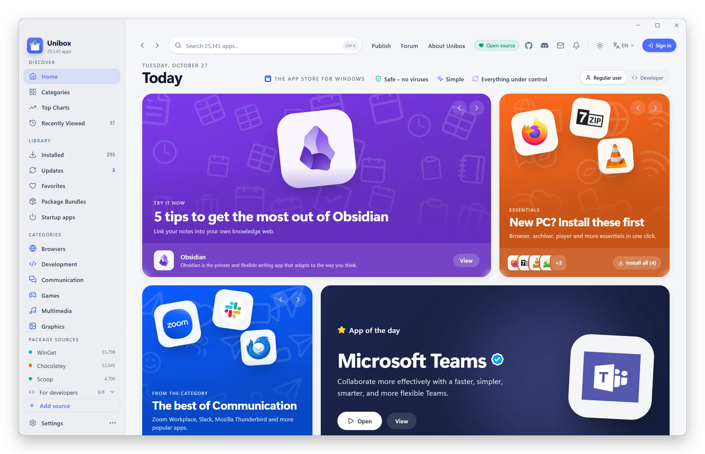
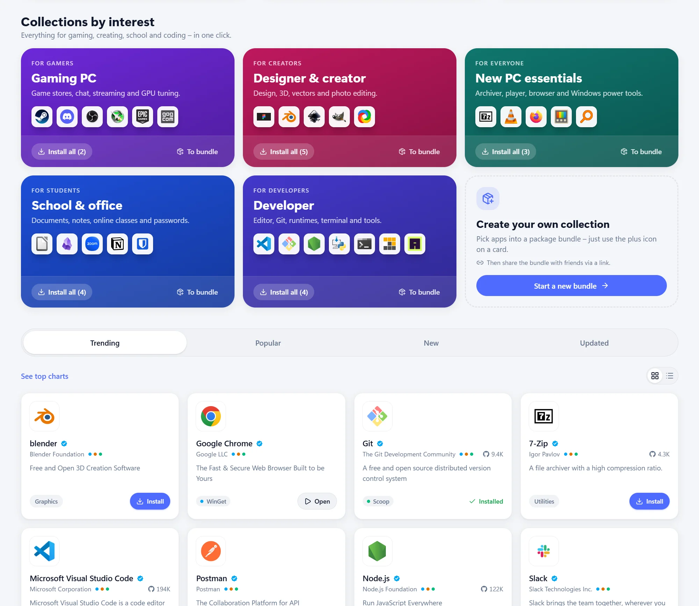
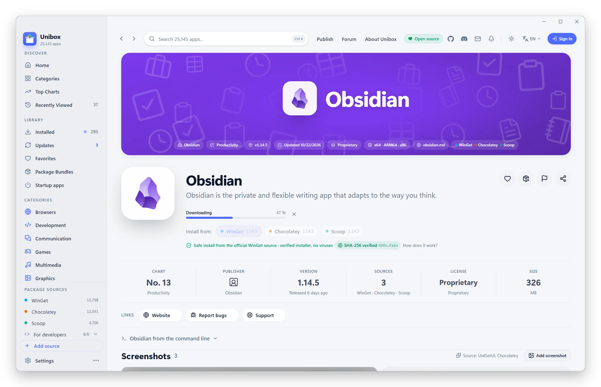
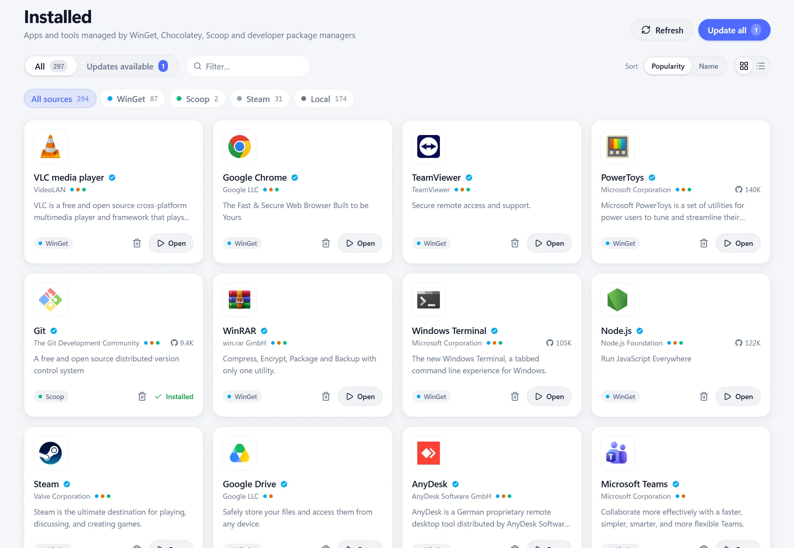

<div align="center">

**English** · [Čeština](README.cs.md)


# Unibox

### One store for every app on Windows

A modern app store for Windows 10 and 11. More than **25,000 apps** from the official
WinGet, Chocolatey and Scoop repositories – install them in one click, without hunting
for installers on the web, with no ads and no bundled extras.

[](LICENSE) [](#download) [](https://tauri.app) [](https://react.dev) [](#free-and-open-source)

**[⬇️ Download for Windows](https://github.com/matous96/unibox/releases/latest)** &nbsp;·&nbsp; [Tour](#tour) &nbsp;·&nbsp; [Package managers](#package-managers) &nbsp;·&nbsp; [For developers](#for-developers)

<br>

<picture>
  <source media="(prefers-color-scheme: dark)" srcset="assets/readme/okno-tmave.webp">
  
</picture>

The Today page – tips, collections and the App of the Day. In English and Czech, light and dark theme to match Windows.

</div>

## Why Unibox

| 🛡️ Safe – no viruses | ⚡ Simple | 🔄 Everything under control |
|:---|:---|:---|
| Only the official repositories of package managers. Every installer is verified against its SHA-256 checksum before it runs. | One click instead of setup wizards. No “Next, Next, Finish”, no bundled extras and no ads. | Updates and uninstalls for all your apps in one place – even the ones you installed earlier and some other way. |

One app = one card. When an app is available from several package managers, its card
shows every source with its version and you choose where to install it from.

## Tour

### Store and catalog

A **Today** home page with tips from hundreds of well-known apps and a new App of the Day
every day, categories, charts and collections for gamers, creators, students and
developers. Search with <kbd>Ctrl</kbd>+<kbd>K</kbd> covers the catalog and searches
package managers live; verified apps come first.

<picture>
  <source media="(prefers-color-scheme: dark)" srcset="website/img/screens/en/kolekce.webp">
  
</picture>

### App pages like in the App Store

A large banner in the colors of the app's icon, a screenshot gallery with a full-screen
viewer, what's new, ratings and reviews, privacy details and links to the website,
GitHub, documentation and support. Technical details: SHA-256, installer type, system
requirements and dependencies.

Install in one click from the source you choose, with download progress right on the app page.

<p align="center">
<picture>
  <source media="(prefers-color-scheme: dark)" srcset="assets/readme/stahovani-tmave.webp">
  
</picture>
</p>

### Installed apps and updates

An overview of every app on your computer – including programs installed outside WinGet,
Microsoft Store apps and Steam games. Install updates with one **Update all** button or
automatically on a schedule. When an operation fails because of permissions, Unibox
retries it with administrator rights by itself.

<picture>
  <source media="(prefers-color-scheme: dark)" srcset="website/img/screens/en/nainstalovane.webp">
  
</picture>

### And more

- 🧹 **Advanced uninstall** – finds what uninstallers leave behind (AppData, Program Files,
  the Start menu, the registry) and offers to delete it; with **install tracking** it
  removes exactly what the installer created.
- 🚀 **Startup apps** – programs that start when you sign in to Windows, in one place,
  with their impact on startup speed.
- ⏰ **Updates under control** – schedules for checks and installs, a minimum age for
  updates, battery exceptions and a warning when an installer comes from a different host.
- 📦 **Package bundles and profiles** – a shareable set of apps for a new PC, export for
  WinGet or as a PowerShell script.
- 💻 **Developer mode** – npm, Bun, pip, Cargo, vcpkg, .NET Tool and PowerShell for real,
  plus command-line commands ready to copy.
- ⭐ **Community** – sign in with GitHub, ratings, reviews and current screenshots from
  users; sync your favorites and preferences between computers.
- 🌙 **A modern window** in the Windows 11 style, light and dark theme, English and Czech;
  close the window and installs finish in the background.

## Package managers

| Manager | Status | What it does |
|---|---|---|
| **WinGet** | ✅ fully working | search, install, update, uninstall and download installers |
| **Chocolatey** | ✅ fully working | search, install, update and uninstall; installs Chocolatey itself if it's missing |
| **Scoop** | ✅ fully working | no administrator rights needed; adds a missing Scoop, Git and buckets by itself |
| **npm, Bun, pip, Cargo, vcpkg, .NET Tool, PowerShell** | ✅ Developer mode | libraries and tools; installs a missing Node.js, Python or Rust via WinGet |

## Download

**[Download the latest version](https://github.com/matous96/unibox/releases/latest)** –
the **EXE** installer installs for the current user without administrator rights, the
**MSI** suits company deployments. Requirements: Windows 10 or 11 (64-bit) and WebView2,
which comes preinstalled with Windows. Unibox then keeps itself up to date.

> [!NOTE]
> The installer isn't digitally signed yet (signing through the SignPath Foundation is
> on the way), so Windows SmartScreen shows a warning on the first run:
> **More info → Run anyway**.

## Free and open source

Unibox is free, with no ads and no telemetry, under the [MIT](LICENSE) license. The
catalog is generated every day on GitHub Actions; sign-in, ratings and sync run on the
free tier of Supabase. Signing in is optional – everything except ratings, reviews and
sync works without an account.

## For developers

Tauri 2 (Rust) + React 19 + TypeScript + Tailwind CSS v4 + Vite, with a data pipeline in
Node.js. Requirements: Node.js 24, pnpm 10 and, for the desktop app, Rust and Visual Studio
Build Tools with C++.

```bash
pnpm install
pnpm dev                # web version with sample data at http://localhost:1420
pnpm desktop            # desktop app (Tauri) with hot reload
pnpm pipeline --local   # build the real catalog into public/catalog.json
pnpm typecheck          # type checks
```

| Folder | Contents |
|---|---|
| [`src/`](src) | React UI – pages, components, stores and services for package managers |
| [`src-tauri/`](src-tauri) | Rust backend – package manager engine, UAC, tray, updater, installer |
| [`data-pipeline/`](data-pipeline) | catalog generator from WinGet, Chocolatey and Scoop |
| [`supabase/migrations/`](supabase/migrations) | database for sign-in, ratings, reviews, screenshots and sync |
| [`website/`](website) | the project website (Czech and English) |
| [`.github/workflows/`](.github/workflows) | daily catalog, releases and Supabase maintenance |

The full developer documentation – Supabase setup, signing, releases, the catalog and
every app feature – is in Czech in [README.cs.md](README.cs.md#dokumentace-pro-vývojáře).
Issues and pull requests are welcome, including new translations
([`src/i18n/locales`](src/i18n/locales)).

## License

[MIT](LICENSE) © Unibox contributors
